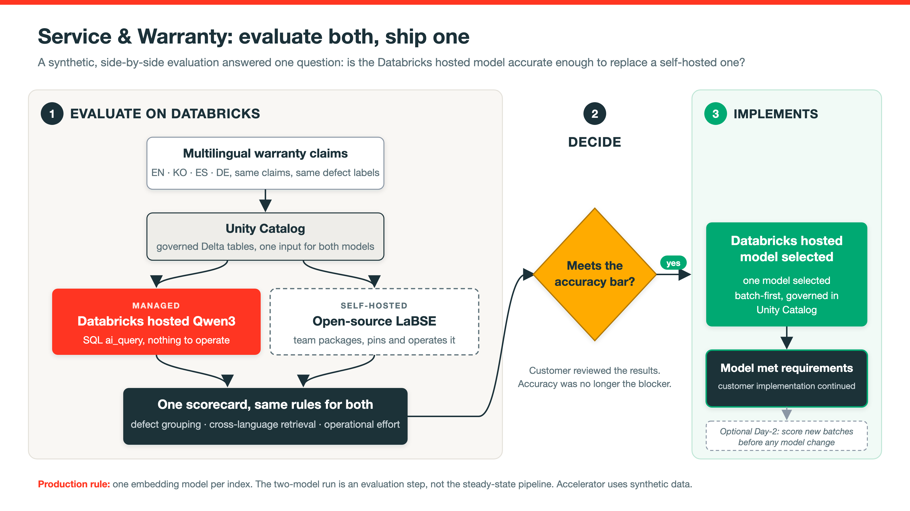

# Multilingual Embedding Model Evaluation Accelerator

Evaluate both, ship one. Use this repository to compare a Databricks-managed embedding model with a self-hosted open-source model on the same labeled multilingual claims, then choose **one** model from a queryable Unity Catalog scorecard.

The corpus is synthetic. It shows the evaluation method. It is not a live customer system. A separate optional job shows Day-2 monitoring after a model has been selected.

## What this proves

The question is not whether two models should run together in production. It is whether a managed model meets the accuracy bar well enough that you no longer have to host and operate one.

The evaluation generates 144 synthetic warranty-style claims in English, Korean, Spanish, and German. Both candidates receive the same text and labels:

- **Qwen3** (`databricks-qwen3-embedding-0-6b`): Databricks-managed, 1024-dim, Public Preview, called with `ai_query`.
- **LaBSE** (`sentence-transformers/LaBSE`, pinned revision): open-source, 768-dim, Apache-2.0, loaded in the notebook.

The scorecard compares semantic separation, cluster purity, Adjusted Rand Index, and top-1 cross-lingual retrieval. Meeting the bar does not require winning every metric. If both candidates are good enough, the remaining choice is operational: use the managed model to avoid hosting infrastructure, or keep the self-hosted model when you need direct control of an open model.

Production uses one selected model. **Do not mix the two vector spaces in one index.**

## Architecture



Slide source: [`src/diagrams/evaluate_both_ship_one.svg`](src/diagrams/evaluate_both_ship_one.svg).

| Stage | What it is | What it does |
|---|---|---|
| 1. Synthetic claims | Seeded Python generator in the base notebook | Builds 144 labeled rows so anyone can reproduce the corpus without customer data. |
| 2. Delta / Unity Catalog | Schema + tables in **your** catalog | Stores claims and embeddings with governance. Catalog and schema are widgets / bundle variables. |
| 3a. Qwen3 | Foundation Model API via `ai_query` | Batch-embeds every claim. Needs workspace entitlement to that preview endpoint. |
| 3b. LaBSE | Pinned Sentence-Transformers model | Embeds the same texts locally in the notebook. Needs outbound access to Hugging Face (or a mirrored copy). |
| 4. Decision scorecard | Cosine margin, KMeans purity / ARI, top-1 retrieval | Writes one `comparison_metrics` table that shows whether each candidate meets the required quality bar. |
| 5. Model decision | Accuracy plus operational trade-offs | Selects one model for production. The evaluation is not the normal serving path. |

### Optional operational extension

The separate `warranty_model_monitoring` job simulates later weekly batches, scores them against prior centroids, applies quality thresholds, logs MLflow evidence, and populates dashboard tables. It is guidance for operating the selected model, not evidence that a customer runs this exact job. The repository does not configure a calendar schedule.

## Use in your workspace

Set these for your environment:

| Value | Where | Example |
|---|---|---|
| Databricks CLI profile | `-p <profile>` after `databricks auth login` | your profile name |
| `catalog` | bundle `--var` or notebook widget | `main` or any catalog where you can create a schema |
| `schema` | optional `--var` or widget | `multilingual_warranty_demo` (default is isolated by user short name) |
| `warehouse_id` | required for the dashboard | ID from SQL Warehouses |

```bash
git clone https://github.com/archana986/multilingual-warranty-early-warning.git
cd multilingual-warranty-early-warning

databricks auth login --host <your-workspace-url> -p <profile>

databricks bundle validate --strict -p <profile> \
  --var="catalog=<your_catalog>,warehouse_id=<warehouse-id>"

databricks bundle deploy -p <profile> \
  --var="catalog=<your_catalog>,warehouse_id=<warehouse-id>"

databricks bundle run warranty_model_evaluation -p <profile> \
  --var="catalog=<your_catalog>,warehouse_id=<warehouse-id>"
```

Optional: `--var="...,schema=<dedicated_schema>"`. Use an isolated schema; reruns overwrite tables there.

Run the optional monitoring extension only after the evaluation has created its base tables:

```bash
databricks bundle run warranty_model_monitoring -p <profile> \
  --var="catalog=<your_catalog>,warehouse_id=<warehouse-id>"
```

Prerequisites, interactive execution, air-gap guidance, and cleanup: [SETUP.md](SETUP.md).

Local checks (no Databricks call):

```bash
python -m unittest discover -s tests -v
```

### Interactive path (no job)

1. Import `src/notebooks/multilingual_warranty_qwen3_vs_labse.ipynb`.
2. Attach serverless, set the `catalog` and `schema` widgets, and Run All.
3. Query `<catalog>.<schema>.comparison_metrics` to review the decision scorecard.
4. Optional: import and run `05_monitoring_and_aiops.ipynb` with the same widgets.
5. Optional: import the dashboard and bind it to the monitoring schema and warehouse.

## Adopt (bring your own claims)

The synthetic generator is only for the out-of-the-box demo. To use your own data:

1. Keep the same column contract: `claim_id`, `defect_id` (or ground-truth label), `language`, `claim_text`.
2. Point the base notebook (or a thin wrapper) at your table instead of generating `rows`.
3. Use one embedding model per vector index. Do not mix Qwen3 (1024-dim) and LaBSE (768-dim) in the same index.
4. Define acceptance thresholds before reading the results.
5. If adopting the optional monitoring extension, keep it on the same catalog and schema and recalibrate all thresholds on representative history.

## Update (after you change code or pull)

| Change | What to do |
|---|---|
| Pull latest from GitHub | `git pull`, then deploy and rerun `warranty_model_evaluation` with the same vars |
| Evaluation notebook or resource edits | Deploy, then rerun `warranty_model_evaluation` |
| Monitoring notebook edits | Deploy, then rerun `warranty_model_monitoring` |
| One-off catalog/schema for a run | pass `--var` on the CLI (overrides defaults for that command) |
| Interactive widgets | set `catalog` / `schema` in the notebook UI; does not change the bundle YAML |
| Defaults for a target | edit `variables` / `targets` in `databricks.yml`, then validate and deploy |
| Remove job and dashboard only | `databricks bundle destroy` (does **not** drop UC tables) |
| Drop demo tables | `DROP SCHEMA \`<catalog>\`.\`<schema>\` CASCADE` on a schema dedicated to this demo |

## What each repo file does

| Path | Role |
|---|---|
| `databricks.yml` | Bundle name, `catalog` / `schema` / `warehouse_id` variables, deploy targets. |
| `resources/warranty_demo.job.yml` | Evaluation job that runs the head-to-head model comparison. |
| `resources/warranty_monitoring.job.yml` | Separate optional Day-2 monitoring job. |
| `resources/warranty_monitoring.dashboard.yml` | Deploys the Lakeview dashboard with parameterized catalog and schema. |
| `src/notebooks/multilingual_warranty_qwen3_vs_labse.ipynb` | Generates identical labeled inputs, evaluates Qwen3 and LaBSE, and writes `comparison_metrics`. |
| `src/notebooks/05_monitoring_and_aiops.ipynb` | Optional extension: synthetic batches, latency, prior-batch drift, quality gate, cost, MLflow, dashboard tables. |
| `src/dashboards/warranty_monitoring.lvdash.json` | Dashboard datasets (unqualified table names; catalog/schema applied at deploy). |
| `src/diagrams/` | Architecture slide PNG and SVG used in this README. |
| `tests/test_portability.py` | Static fork-and-run contract checks. |
| `SETUP.md` | Prerequisites, interactive steps, air-gap, cleanup, known limits. |

## Results (small synthetic corpus)

Release validation ran on 2026-10-13 on Azure Databricks serverless. The `comparison_metrics` table contained:

- **Databricks-managed Qwen3:** cluster purity 0.875, ARI 0.779, top-1 cross-lingual retrieval 0.993, semantic separation margin 0.215.
- **Self-hosted LaBSE:** cluster purity 0.778, ARI 0.674, top-1 cross-lingual retrieval 1.000, semantic separation margin 0.297.

On this corpus, Qwen3 led clustering (purity and ARI). LaBSE led semantic separation and was slightly higher on top-1 retrieval. The hosted model met the accuracy bar. It did not beat LaBSE on every measure. These numbers demonstrate the decision method. They are not customer acceptance results. Managed endpoint behavior can change, so rerun the evaluation and set thresholds on your own labeled data.

**Optional monitoring result:** the separately executed monitoring job completed successfully. Its latest simulated week, 2026-08-10, passed with purity 0.854, ARI 0.761, and retrieval 0.993. This remains operational guidance, not part of the model-selection scorecard or a customer production claim.

## License

Demo code and synthetic text are provided as-is for internal reuse. Add an organization-approved license if you redistribute outside that audience.
