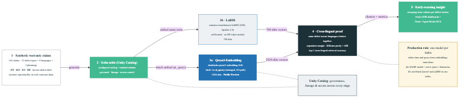

# Multilingual Warranty Early-Warning: Qwen3 vs LaBSE

Fork this repository, point it at your Databricks workspace, and run the same synthetic comparison on a clean schema. No real warranty data is included.

This README is the GitHub source of truth. A `databricks bundle deploy` uploads notebooks, the job, and the dashboard. It does **not** publish this README or the architecture image into the workspace. Read here first, then deploy.

## What this proves

Warranty-style claims in English, Korean, Spanish, and German should cluster by the **same physical defect**, not by language. The demo generates 144 synthetic claims (12 defects × 4 languages × 3 phrasings), embeds them with two models on the **same text**, and reports clustering and retrieval metrics.

- **Qwen3** (`databricks-qwen3-embedding-0-6b`): Databricks-managed, 1024-dim, Public Preview, called with `ai_query`.
- **LaBSE** (`sentence-transformers/LaBSE`, pinned revision): open-source, 768-dim, Apache-2.0, loaded in the notebook.

Both can recover the defect structure on this corpus. The operational choice is managed vs self-hosted, not “only one model works.” **Do not mix the two vector spaces in one index.**

## Architecture



Editable source: [`src/diagrams/warranty_qwen3_vs_labse_demo.mmd`](src/diagrams/warranty_qwen3_vs_labse_demo.mmd).

| Stage | What it is | What it does |
|---|---|---|
| 1. Synthetic claims | Seeded Python generator in the base notebook | Builds 144 labeled rows so anyone can reproduce the corpus without customer data. |
| 2. Delta / Unity Catalog | Schema + tables in **your** catalog | Stores claims and embeddings with governance. Catalog and schema are widgets / bundle variables. |
| 3a. Qwen3 | Foundation Model API via `ai_query` | Batch-embeds every claim. Needs workspace entitlement to that preview endpoint. |
| 3b. LaBSE | Pinned Sentence-Transformers model | Embeds the same texts locally in the notebook. Needs outbound access to Hugging Face (or a mirrored copy). |
| 4. Cross-lingual proof | Cosine margin, KMeans purity / ARI, top-1 retrieval | Scores whether the same defect stays close across languages. |
| 5. Early-warning / Day-2 | Second notebook + five monitoring tables | Simulates weekly batches, scores **new** batches against **prior** centroids, quality-gates metrics, optional billing, MLflow config log. |
| Dashboard | Lakeview JSON + bundle `dataset_catalog` / `dataset_schema` | Charts drift, quality, latency, optional cost, and alerts. Needs a SQL warehouse ID at deploy time. |
| Job | Two serverless notebook tasks | Runs base comparison, then monitoring, in order. |

Unity Catalog governs tables and lineage. The Day-2 notebook does **not** register a fake UC “model” for the managed endpoint. It logs evaluation parameters in MLflow.

## Use in your workspace

Set these for your environment:

| Value | Where | Example |
|---|---|---|
| Databricks CLI profile | `-p <profile>` after `databricks auth login` | your profile name |
| `catalog` | bundle `--var` or notebook widget | `main` or any catalog where you can create a schema |
| `schema` | optional `--var` or widget | `multilingual_warranty_demo` (default is isolated by user short name) |
| `warehouse_id` | required for the dashboard | ID from SQL Warehouses |

```bash
git clone https://github.com/archana986/multilingual-warranty-early-warning.git
cd multilingual-warranty-early-warning

databricks auth login --host <your-workspace-url> -p <profile>

databricks bundle validate --strict -p <profile> \
  --var="catalog=<your_catalog>,warehouse_id=<warehouse-id>"

databricks bundle deploy -p <profile> \
  --var="catalog=<your_catalog>,warehouse_id=<warehouse-id>"

databricks bundle run warranty_embedding_demo -p <profile> \
  --var="catalog=<your_catalog>,warehouse_id=<warehouse-id>"
```

Optional: `--var="...,schema=<dedicated_schema>"`. Use an isolated schema; reruns overwrite tables there.

Prerequisites, interactive Run All, air-gap, and cleanup: [SETUP.md](SETUP.md).

Local checks (no Databricks call):

```bash
python -m unittest discover -s tests -v
```

### Interactive path (no job)

1. Import `src/notebooks/multilingual_warranty_qwen3_vs_labse.ipynb` and `src/notebooks/05_monitoring_and_aiops.ipynb`.
2. Attach serverless. Set the same `catalog` and `schema` widgets on both.
3. Run All on the base notebook, then Run All on the Day-2 notebook.
4. Import `src/dashboards/warranty_monitoring.lvdash.json` and bind it to the same catalog, schema, and warehouse.

## Adopt (bring your own claims)

The synthetic generator is only for the out-of-the-box demo. To use your own data:

1. Keep the same column contract: `claim_id`, `defect_id` (or ground-truth label), `language`, `claim_text`.
2. Point the base notebook (or a thin wrapper) at your table instead of generating `rows`.
3. Use one embedding model per vector index. Do not mix Qwen3 (1024-dim) and LaBSE (768-dim) in the same index.
4. Keep Day-2 on the same catalog and schema as the base run so monitoring tables align.
5. Retune quality gates and the out-of-distribution threshold on labeled history before treating alerts as production.

## Update (after you change code or pull)

| Change | What to do |
|---|---|
| Pull latest from GitHub | `git pull`, then `bundle deploy` and `bundle run` again with the same vars |
| Notebook or resource YAML edits | `databricks bundle deploy` to sync workspace files, then rerun the job |
| One-off catalog/schema for a run | pass `--var` on the CLI (overrides defaults for that command) |
| Interactive widgets | set `catalog` / `schema` in the notebook UI; does not change the bundle YAML |
| Defaults for a target | edit `variables` / `targets` in `databricks.yml`, then validate and deploy |
| Remove job and dashboard only | `databricks bundle destroy` (does **not** drop UC tables) |
| Drop demo tables | `DROP SCHEMA \`<catalog>\`.\`<schema>\` CASCADE` on a schema dedicated to this demo |

## What each repo file does

| Path | Role |
|---|---|
| `databricks.yml` | Bundle name, `catalog` / `schema` / `warehouse_id` variables, deploy targets. |
| `resources/warranty_demo.job.yml` | Two-task job: compare, then monitor. Passes catalog and schema into both notebooks. |
| `resources/warranty_monitoring.dashboard.yml` | Deploys the Lakeview dashboard with parameterized catalog and schema. |
| `src/notebooks/multilingual_warranty_qwen3_vs_labse.ipynb` | Generate data, Qwen3 + LaBSE, metrics, cluster volume view. |
| `src/notebooks/05_monitoring_and_aiops.ipynb` | Batches, latency, prior-batch drift, quality gate, optional cost, MLflow log, dashboard tables. |
| `src/dashboards/warranty_monitoring.lvdash.json` | Dashboard datasets (unqualified table names; catalog/schema applied at deploy). |
| `src/diagrams/` | Architecture PNG (this README) and Mermaid source. |
| `tests/test_portability.py` | Static fork-and-run contract checks. |
| `SETUP.md` | Prerequisites, interactive steps, air-gap, cleanup, known limits. |

## Results (small synthetic corpus)

Latest run: 2026-10-04 on Azure Databricks serverless. Re-run in your workspace; managed endpoints can change, so numbers move between runs.

- Cluster purity: Qwen3 0.875, LaBSE 0.778 (earlier run: LaBSE 0.771)
- ARI: Qwen3 0.779, LaBSE 0.674 (earlier runs: Qwen3 0.767 and 0.764, LaBSE 0.641)
- Top-1 cross-lingual retrieval: Qwen3 0.993, LaBSE 1.000 (same in both runs)
- Day-2 quality gate: the latest simulated week (2026-08-10) scored purity 0.785 against a 0.80 minimum, so the gate failed and blocked promotion. This is the intended behavior of the gate.

## License

Demo code and synthetic text are provided as-is for internal reuse. Add an organization-approved license if you redistribute outside that audience.
